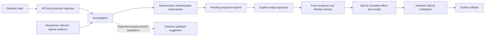

# SentinelOps SOC 2.0

**Synthetic demo:** follow [START_HERE.md](START_HERE.md). No VM or live API credentials are needed.

SentinelOps is a local security-operations prototype that takes a synthetic alert
through investigation, authenticated evidence, analyst review, simulated response,
verification and rollback. Responses change SQLite records only. No firewall,
cloud account, host agent or production network is controlled by this project.
The name means a security operations center project version; it does not claim
SOC 2 compliance or certification.

The repository separates application code in `app/`, regression suites in `tests/`,
operator commands in `scripts/`, and guides, evidence and the presentation in
`docs/`. Use `manage.py` from the root for common commands. See the
[folder map](docs/FILE_STRUCTURE.md) and [upload guide](GITHUB_UPLOAD.md).

## Local setup

Supported and locally tested: Windows, Python 3.15.0 and Node.js 26.7.0. Node 20+
is required by frontend contract tests. Python dependencies are pinned to 35
packages. No frontend package installation or build is required.

For a new empty folder extracted from this organized source archive:

```powershell
py -3.15 -m venv .venv
.\.venv\Scripts\python.exe -m pip install -r .\requirements.txt
if ($LASTEXITCODE -ne 0) { throw 'Dependency installation failed' }
.\.venv\Scripts\python.exe -m pip check
if ($LASTEXITCODE -ne 0) { throw 'Dependency check failed' }
node --version
.\.venv\Scripts\python.exe .\manage.py checks --socket-free-http
if ($LASTEXITCODE -ne 0) { throw 'Gate failed; inspect STEP12_TEST_RESULTS.txt' }
.\.venv\Scripts\python.exe .\manage.py demo
```

Open http://127.0.0.1:8765/dashboard. Connect as demo_analyst with the launcher's
generated one-session token. Keep the token-bearing terminal private. The demo
uses temporary databases, disables live Gemini and seeds three synthetic cases.
Stop with Ctrl+C to remove its databases. Restart for fresh evidence after ten
minutes. No .env or production credentials are needed.

This is a complete organized source tree. Extract into a new folder and follow
these commands. No historical overlay installer is needed. Existing .env and
databases stay private in your working project; they are not in this archive.

## Architecture



The model cannot approve or execute. Synthetic placeholder evidence cannot
authorize execution. The authenticated path requires two current signed
observations bound to the incident and source IP. Approval and execution are
separate calls. Execution rechecks identity, collector state, evidence age and
the immutable approval binding inside coordinated transactions.

Three SQLite stores separate incident/response data, analyst identity, and
collector trust state. Signing keys come from server configuration; analyst
tokens are stored as hashes. The browser keeps analyst credentials in memory.
[Architecture](docs/ARCHITECTURE.md) explains the boundaries and lifecycle.

## API and authentication

| Surface | Authentication | Purpose |
| --- | --- | --- |
| GET /health, /dashboard | Public | Health and static dashboard shell |
| POST /webhook/alert, /simulate/attack | X-API-Key | Ingestion / synthetic alert |
| POST /alerts/{id}/investigate | X-API-Key | Initial bounded investigation |
| POST /incidents/{id}/evidence/submit | API key plus signed envelope | Evidence ingestion |
| POST /incidents/{id}/investigate-authenticated | Analyst/admin | Assessment from current signed observations |
| POST /response-requests/for-incident/{id} | Analyst/admin | Propose a pending request |
| POST /response-requests/{id}/decision | Analyst/admin | APPROVED or REJECTED with reason |
| POST /response-requests/{id}/execute | Analyst/admin plus Idempotency-Key | SQLite simulation only |
| POST /response-requests/{id}/verify | Analyst/admin | Synthetic verification |
| POST /response-requests/{id}/rollback | Analyst/admin plus Idempotency-Key | Remove the simulated effect |
| GET /alerts, /incidents, /response-requests, /audit-history | Viewer or analyst/admin | Protected history |
| GET /incidents/{id}/evidence, /simulated-blocks, /ai/status | Viewer or analyst/admin | Evidence, effects and config |
| GET /dashboard/api/identity, /overview, /incidents/{id} | Viewer or analyst/admin | Safe dashboard snapshots |

Analyst headers are X-Analyst-Id and X-Analyst-Token. A viewer cannot mutate.
Idempotency keys contain 16–128 ASCII letters, digits, hyphens or underscores.
Reuse a key only to retry the same operation. A replayed receipt is historical;
it does not recreate an effect after rollback. Full schemas are in /openapi.json
and the local /docs page. The legacy /incidents/{alert_id}/investigate alias takes
an **alert** ID; use the canonical /alerts route for new integrations.

## Repeatable validation

```powershell
.\.venv\Scripts\python.exe .\manage.py checks --socket-free-http
if ($LASTEXITCODE -ne 0) { throw 'Regression gate failed' }
$report = ".\walkthrough-$((Get-Date).ToString('yyyyMMdd-HHmmss')).json"
.\.venv\Scripts\python.exe .\manage.py walkthrough --output $report
if ($LASTEXITCODE -ne 0) { throw 'Walkthrough failed' }
```

Expected: **30/30 test jobs passed; cleanup: PASSED**, then **9/9 walkthrough
stages passed; cleanup: PASSED**. These are jobs/stages, not assertion counts.
All 28 Step 11 jobs remain, including three concurrency repetitions. Two new jobs
validate the final replay and documentation/route contracts. Each job uses a
disposable source copy; non-loopback outbound Python network calls are blocked.
`--socket-free-http` exercises actual in-process ASGI HTTP routes without a
listening socket. It does not test browser rendering or TCP integration.

The replay covers current signed synthetic evidence, missing/viewer authorization,
execution before approval, explicit approval, simulated execution, duplicate
execution, verification, rollback/retry and historical replay after rollback.
Its JSON excludes credentials, raw evidence envelopes and database paths.

## Configuration and operations

See [Step 11 operations](docs/guides/README_STEP11.md) for configuration, identity provisioning,
collector registration, backup/restore and staged schema upgrades. The supported
launcher is `python manage.py serve`: loopback, one worker, dependency checks and an
allowlist of .env settings. Do not overwrite an existing .env with .env.example.

Optional Gemini requires your local GEMINI_API_KEY, an explicit GEMINI_MODEL and
SENTINELOPS_GEMINI_ENABLED=1. Attempts require at least 10000 ms; defaults are
15000 ms per attempt and a 60000 ms workflow budget. The offline gate makes no
live provider call. Earlier operator-reported live success does not establish
current credentials or provider availability.

The ci/ file is a template, not an installed GitHub workflow. Docker is experimental
and unexecuted here. The clean-source ZIP contains no .env, SQLite data, credentials,
virtual environment, Git history or private backup.

## Portfolio handoff

- [Three-minute walkthrough and capture plan](docs/DEMO_SCRIPT.md)
- [Threat model and limitations](docs/THREAT_MODEL.md)
- [Final evidence and release checklist](docs/FINAL_VALIDATION.md)
- [Technical presentation outline](docs/PRESENTATION.md)

The companion editable PPTX is distributed separately from source. Actual browser
screenshots and a dashboard video remain a manual capture task: browser connections
were unavailable in the restricted build environment. No diagram or slide is
represented as a screenshot. Synthetic observations and SQLite probes do not
establish real attack efficacy, network containment or production readiness.
